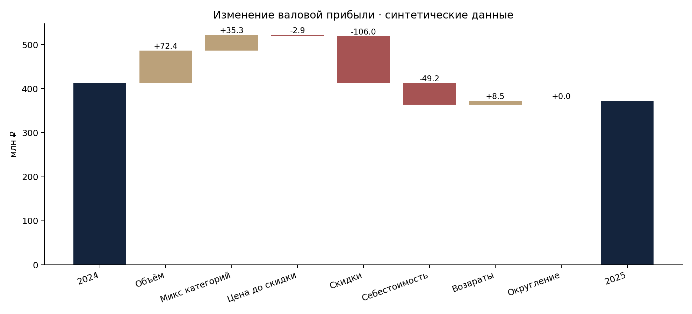
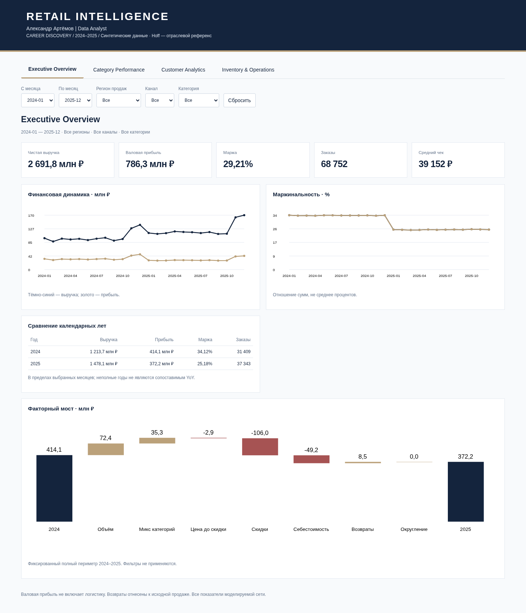
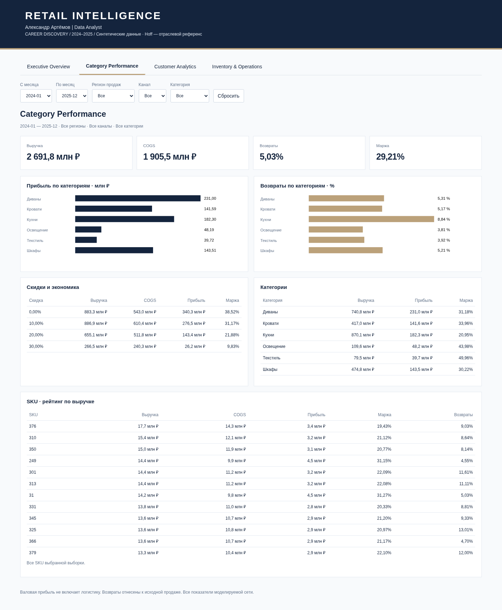
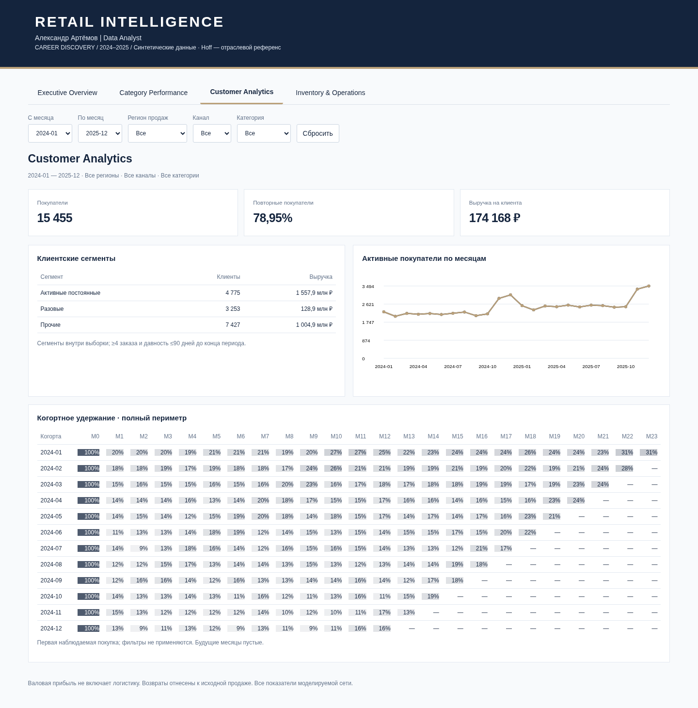
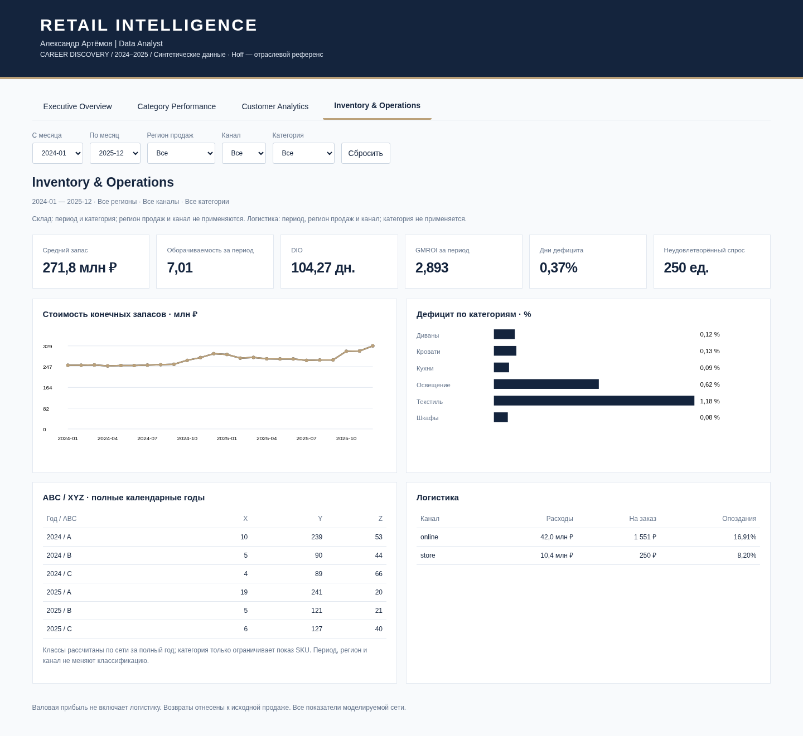
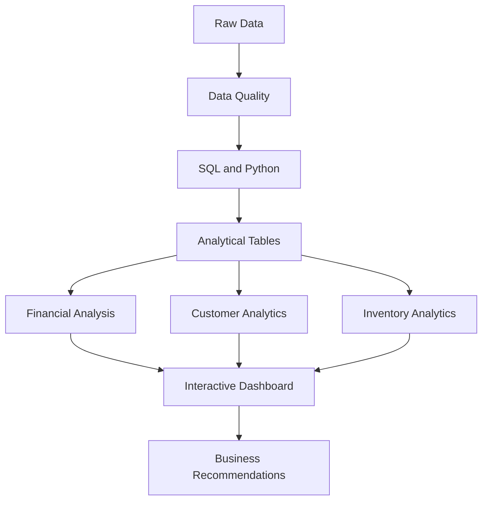

# RETAIL INTELLIGENCE
### Аналитика розничной торговли | 2024–2025

**Александр Артёмов · Data Analytics Portfolio**

`SQL` · `Python` · `Pandas` · `PostgreSQL` · `SQLite` · `Jupyter Notebook` · `Business Intelligence`

---

## 01. О проекте

Комплексный учебно-практический аналитический кейс мебельной розничной сети, охватывающий финансовую, коммерческую, клиентскую и операционную аналитику.

**Главный бизнес-вопрос:** почему рост выручки сопровождается снижением валовой прибыли и рентабельности бизнеса?

Проект объединяет реляционную модель данных, аналитические SQL-запросы, обработку данных на Python, факторный анализ, проверку бизнес-гипотез и интерактивную визуализацию результатов.

> Все данные синтетические. Hoff используется исключительно как отраслевой референс, не является работодателем или источником внутренних данных. Проект подготовлен в рамках карьерного портфолио с использованием ИИ-инструментов.

## 02. Материалы проекта

| Материал | Содержание |
|---|---|
| [Краткое портфолио PDF](portfolio/Portfolio_SHORT_Premium.pdf) | Бизнес-контекст и основные результаты |
| [Полное портфолио PDF](portfolio/Portfolio_FULL_Premium.pdf) | Методология, архитектура и детальная аналитика |
| [Jupyter Notebook](Retail_Analysis.ipynb) | Аналитическое исследование |
| [SQL-запросы](sql/) | Аналитические запросы и структура базы |
| [Python-скрипты](scripts/) | Обработка данных и расчёт показателей |
| [Датасеты](data/) | Исходные и обработанные данные |
| [Документация](docs/) | Методология и ограничения |
| [HTML-дашборд](dashboard.html) | Автономная интерактивная аналитика |

Для интерактивного просмотра скачайте dashboard.html и откройте его в браузере.

---

## 03. Масштаб исследования

| Показатель | Объём |
|---|---:|
| Период анализа | 2024–2025 |
| Заказы | 72 000 |
| Клиенты | 18 000 |
| Товарные позиции | 600 |
| Магазины | 6 |
| Склады | 3 |
| Таблицы реляционной модели | 13 |
| SQL-запросы | 29 |
| Разделы дашборда | 4 |

## 04. Ключевые финансовые результаты

| Метрика | 2024 | 2025 | Динамика |
|---|---:|---:|---:|
| Чистая товарная выручка | 1 213,72 млн ₽ | 1 478,05 млн ₽ | +21,8% |
| Валовая прибыль | 414,10 млн ₽ | 372,21 млн ₽ | −10,1% |
| Валовая маржа | 34,12% | 25,18% | −8,94 п.п. |
| Завершённые заказы | 31 409 | 37 343 | +18,9% |
| Средний чек | 38 642 ₽ | 39 580 ₽ | +2,4% |
| GMROI | 1,614 | 1,297 | −19,6% |

**Ключевой вывод:** рост оборота не гарантирует роста прибыльности. В исследуемом сценарии увеличение объёма продаж сопровождается ухудшением маржинальности.

## 05. Факторный анализ валовой прибыли



Исследование рассматривает влияние шести факторов:

- Объём продаж.
- Товарный микс.
- Изменение базовых цен.
- Скидочная политика.
- Себестоимость.
- Возвраты.

Для декомпозиции изменения валовой прибыли применяются последовательный факторный анализ и метод Shapley.

Подробная методология: [Factor Analysis](docs/factor_analysis.md).

## 06. Аналитические направления

| Направление | Методы |
|---|---|
| Financial Analytics | Revenue, Gross Profit, Gross Margin, факторный анализ |
| Commercial Analytics | Категории, ассортимент, скидки, каналы продаж |
| Customer Analytics | RFM, когортный анализ, повторные покупки |
| Inventory Analytics | ABC/XYZ, DIO, оборачиваемость, GMROI |
| Operational Analytics | Возвраты, доставка, складские остатки |
| Data Quality | Проверка ключей, целостности и согласованности данных |

---

## 07. Интерактивный дашборд

### Executive Overview

Общая динамика бизнеса и ключевые финансовые показатели.



### Category Performance

Эффективность товарных категорий, продаж и маржинальности.



### Customer Analytics

Сегментация клиентов, повторные покупки и когортный анализ.



### Inventory & Operations

Эффективность товарных запасов и операционные показатели.



---

## 08. Управленческие рекомендации

По результатам моделируемого исследования сформированы следующие направления для дальнейшей проверки:

1. Пересмотреть скидочную политику с учётом валовой прибыли.
2. Контролировать маржинальность товарных категорий.
3. Оценивать ассортимент не только по выручке, но и по GMROI.
4. Оптимизировать товарные запасы с учётом ABC/XYZ-сегментации.
5. Исследовать причины возвратов и роста логистических затрат.
6. Развивать регулярный мониторинг финансовых и операционных KPI.

Рекомендации являются результатом анализа синтетического сценария, а не подтверждённым эффектом внедрения в реальном бизнесе.

## 09. Архитектура проекта

```text
retail-intelligence/
├── data/
│   ├── raw/
│   └── processed/
├── docs/
├── images/
├── portfolio/
├── scripts/
├── sql/
├── dashboard.html
├── Retail_Analysis.ipynb
├── requirements.txt
└── README.md
```

### Аналитический процесс



## 10. Воспроизведение исследования

Все команды выполняются из корневой директории проекта.

### Установка зависимостей

```bash
pip install -r requirements.txt
```

### Пересборка дашборда из сохранённых данных

```bash
python scripts/dashboard.py
```

### Полный пересчёт аналитических результатов

```bash
python scripts/analyze.py
python scripts/factors.py
python scripts/build.py
python scripts/stage3.py
python scripts/dashboard.py
```

Скрипт factors импортирует stock_metrics. Скрипт build создаёт первые 21 запрос и промежуточный Notebook. Скрипт stage3 расширяет набор до 29 запросов и исполняет итоговый Notebook.

Генератор scripts/generate.py следует запускать только для намеренного восстановления синтетического снимка перед полным пересчётом.

### Jupyter Notebook

Открыть Retail_Analysis.ipynb. Рабочая директория — корень проекта.

### PostgreSQL

В предварительно созданной пустой базе retail:

```bash
psql -v ON_ERROR_STOP=1 -d retail -f sql/schema_postgresql.sql -f sql/import.psql -f sql/view_postgresql.sql -f sql/analysis_postgresql.sql
```

Подготовлено 29 аналитических запросов. SQLite проверен на Stage 3. Исполнение PostgreSQL не подтверждено.

### Браузерное тестирование

Установить Playwright и Chromium. При необходимости изменить путь к Chromium в тестовом скрипте.

```bash
python scripts/test_dashboard.py
```

## 11. Методология и качество данных

- [Словарь данных](docs/data_dictionary.md)
- [Методология исследования](docs/methodology.md)
- [Контроль качества](docs/quality.md)
- [Факторный анализ](docs/factor_analysis.md)
- [Складская аналитика](docs/inventory.md)
- [Руководство по SQL](docs/sql_guide.md)
- [Аналитическое исследование Stage 3](docs/stage3.md)
- [Документация дашборда Stage 4](docs/stage4.md)

Файл docs/dashboard_template.html используется как шаблон дашборда. Скрипт scripts/dashboard.py выполняет сборку. Файл docs/dashboard.js является архивным скриптом предыдущей версии.

## 12. Источники отраслевого контекста

- [Hoff — о компании](https://hoff.ru/about/)
- [Loginom — отраслевой кейс Hoff](https://loginom.ru/sites/default/files/global-files/textpage/2025/Hoff_Reshape.pdf)
- [Retail.ru — динамика бизнеса Hoff](https://www.retail.ru/news/hoff-v-2023-godu-vyruchka-kompanii-vyrosla-na-16-25-yanvarya-2024-237004/)

---

**Александр Артёмов**

Data Analytics · Business Intelligence · SQL · Python

CAREER DISCOVERY | RETAIL INTELLIGENCE
