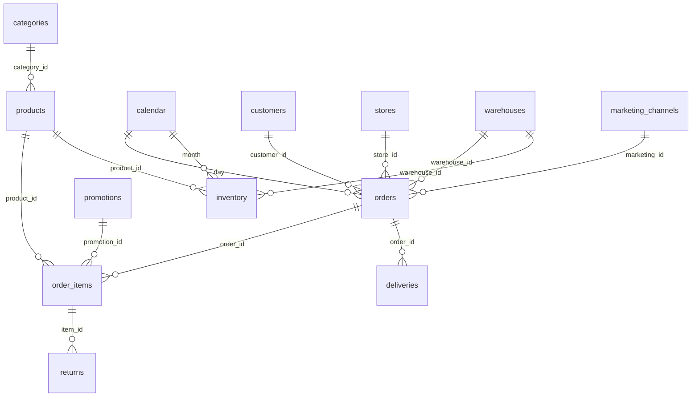

# Словарь данных

|Таблица|Поле|Тип|Ключ|
|---|---|---|---|
|categories|category_id|INTEGER|PK |
|categories|category|TEXT||
|products|product_id|INTEGER|PK |
|products|category_id|INTEGER|FK → categories|
|products|list_price|NUMERIC||
|products|unit_cost|NUMERIC||
|customers|customer_id|INTEGER|PK |
|customers|loyalty|TEXT||
|stores|store_id|INTEGER|PK |
|stores|region|TEXT||
|warehouses|warehouse_id|INTEGER|PK |
|warehouses|region|TEXT||
|calendar|day|TEXT|PK |
|marketing_channels|marketing_id|INTEGER|PK |
|marketing_channels|source|TEXT||
|promotions|promotion_id|INTEGER|PK |
|promotions|discount|NUMERIC||
|orders|order_id|INTEGER|PK |
|orders|day|TEXT|FK → calendar|
|orders|customer_id|INTEGER|FK → customers|
|orders|store_id|INTEGER|FK → stores|
|orders|warehouse_id|INTEGER|FK → warehouses|
|orders|channel|TEXT||
|orders|marketing_id|INTEGER|FK → marketing_channels|
|orders|status|TEXT||
|order_items|item_id|INTEGER|PK |
|order_items|order_id|INTEGER|FK → orders|
|order_items|product_id|INTEGER|FK → products|
|order_items|promotion_id|INTEGER|FK → promotions|
|order_items|quantity|INTEGER||
|order_items|unit_price|NUMERIC||
|order_items|unit_cost|NUMERIC||
|returns|return_id|INTEGER|PK |
|returns|item_id|INTEGER|FK → order_items|
|returns|return_day|TEXT||
|returns|quantity|INTEGER||
|returns|reason|TEXT||
|deliveries|order_id|INTEGER|PK FK → orders|
|deliveries|promised_days|INTEGER||
|deliveries|actual_days|INTEGER||
|deliveries|delivery_cost|INTEGER||
|inventory|month|TEXT|PK FK → calendar|
|inventory|warehouse_id|INTEGER|PK FK → warehouses|
|inventory|product_id|INTEGER|PK FK → products|
|inventory|stock_start|INTEGER||
|inventory|receipts|INTEGER||
|inventory|emergency_receipts|INTEGER||
|inventory|sales|INTEGER||
|inventory|restocked|INTEGER||
|inventory|stock_end|INTEGER||
|inventory|stockout_days|INTEGER||
|inventory|unmet_demand|INTEGER||
|inventory|ordered|INTEGER||
|inventory|lead_days|INTEGER||
|inventory|stock_unit_days|INTEGER||

Гранулярность: справочники — одна строка на ключ; orders — заказ; order_items — позиция; returns — событие возврата; deliveries — завершённый заказ; inventory — SKU × склад × месяц. Денежные поля в рублях без НДС.

